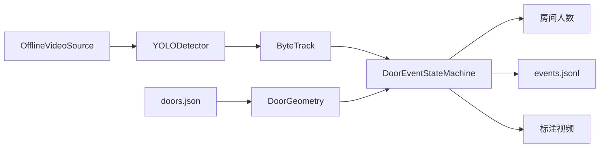

# 门口人数统计技术方案

## 1. 目标

用单路摄像头统计每个房间的当前人数。系统不在房间内部逐帧点人，而是跟踪人体，看头框有没有和门洞四边形重叠：重叠后进入加一，离开减一。同一个 `room_id` 的多扇门累加到同一个房间。

人数是从 `initial_count` 开始的整数累计，可以为负。负值表示启动后出门次数多于进门。

适用前提：

- 每个要统计的门都在画面里，门洞四边形可以标注。
- 人过门时，头框会和门洞四边形发生重叠，离开后再分开。
- 轨迹号只在这一路摄像头内有效，不是身份。

## 2. 总体架构

每帧串行处理。检测跟不上目标帧率时，输入侧先丢掉来不及处理的帧，再把剩下的帧送进这条链路。

```text
视频帧（按目标 FPS 抽帧，时间戳用 PTS）
  → YOLO 人体姿态（框和头部关键点）
  → ByteTrack（速度预测 + 门口放宽起轨）
  → 头框与门洞四边形是否重叠
  → 每个 (track_id, door_id) 的进出状态机
  → 房间原始人数、JSONL 事件、可选可视化
```



| 模块 | 路径 | 职责 |
| --- | --- | --- |
| 入口 | `app.py` | 标注或统计；结束时打印每个房间的人数 |
| 输入 | `src/input/video_source.py` | 抽帧、PTS、实时落后时丢帧 |
| 检测 | `src/models/yolo_detector.py` | YOLO pose，保留 person 框和关键点 |
| 跟踪 | `src/tracking/byte_track.py` | 两阶段 IoU、匀速预测、门口中等置信度起轨 |
| 几何 | `src/geometry/door.py` | 门洞四边形，判断点是否在内部 |
| 事件 | `src/events/state_machine.py` | 同一条轨迹的头框路程，路过不计 |
| 输出 | `src/output/sinks.py` | JSONL，以及带人数的画面 |
| 标注 | `src/annotation/door_annotator.py` | 首帧拖动门洞四边形，并填写房间名称和初始人数 |
| 编排 | `src/pipeline/runner.py` | 按帧串起来，视频结束时补发未完成的过门 |

配置在 `config/doors.json`。坐标是相对宽高的归一化值，读入后乘上分辨率。`initial_count` 是统计开始时已经在房间里的人数，默认 0。两扇门写成同一个 `room_id` 才会计入同一个房间，并且初始人数必须一致。人数本身是整数，不设容量。

## 3. 算法

### 3.1 时间与抽帧

`OfflineVideoSource` 用容器里的 PTS 作为时间戳。PTS 不前进时，退回 `源帧号 / 源帧率`。

目标 FPS 低于源帧率时按比例抽帧。30 FPS 的视频、`--fps 15` 会保留第 0、2、4… 帧，时间戳仍是这些帧自己的 PTS。状态机的稳定和丢失都按时间戳的差值计算，不再按处理了多少帧计算。

`realtime=True` 时，墙上时钟比画面时间落后超过一个输出帧周期，就丢掉这一帧，让处理追上实时。`--no-realtime` 不睡眠也不丢帧，适合离线把抽中的帧全部算完。

### 3.2 检测

`YOLODetector` 使用姿态模型，默认 `yolo11n-pose.pt`。类别只留 COCO person，同时保留 17 个关键点。默认置信度 0.35，输入边长 640。检测框不直接加人数。进出看头框：鼻子、眼睛、耳朵（关键点 0 到 4）置信度不低于 0.3 时，用这些点围成头框并外扩；这些点都不可用时，改用人体框顶部约 22% 的高度。头框和门洞四边形有重叠，才算在门洞里。

### 3.3 跟踪

`ByteTrack` 先把现有轨迹按速度挪到预测位置，再做两阶段匹配：

1. 置信度 ≥ 0.5 的框与轨迹做 IoU 匹配，阈值 0.3。
2. 没配上的轨迹再与置信度在 [0.1, 0.5) 的框匹配，IoU 阈值 0.24。
3. 仍未匹配的高置信度框新建轨迹。门口区域内，置信度 ≥ 0.35 的框也可以新建轨迹。
4. 连续丢失超过 15 帧的轨迹删除。

速度是框中心和宽高的指数滑动，新观测权重 0.75。门口里诞生的轨迹第一帧就输出；其他轨迹至少命中 2 帧才输出。这样人一进门就能参加判侧，不必再等一次额外命中。

### 3.4 门洞四边形

每个门是画面上的一个四边形，四个角按边界顺序排列。坐标仍是相对宽高的归一化值，读入后乘上分辨率。点落在边上算在四边形内。

头中心落在四边形里，这一帧的头才在门洞里。有鼻子用鼻子，没有鼻子时用头框中心。外扩后的头框只表示人回到门口，不单独当作进入。

人体框底边中点当作脚。脚要落在门洞下沿上下、不超过门高四分之一的范围内。脚明显更低，说明人比这扇门更靠近镜头，身体挡住门洞也不算站在门口。人体框同时还用于跟踪：框和四边形相交时，中等置信度框可以马上建轨迹。

### 3.5 进出状态机

每个 `(track_id, door_id)` 记住这条轨迹有没有在门外出现过、头中心当前在哪一侧，以及这扇门还有没有未配对的进入。

1. 脚不在门洞下沿附近时，这一帧按门外处理。近处的人挡住门洞，不会因此进入。
2. 第一次看到头中心在门洞里或在门外，只记下这一侧，不计数。
3. 这条轨迹要先在门外，再靠近门洞。头中心进入四边形，并且脚在下沿附近，才算进入门洞。脚踝没检到时只看头；检到了，脚踝也必须进框或贴着下沿。
4. 还在画面里又退回门外，进入取消。
5. 人已经在门洞里，轨迹消失达到 `lost_seconds`（默认 0.7 秒），记一次进入，并清掉这条 track 的状态。之后同一次出现不再算出。
6. 这扇门有未配对的进入，而且进门那条轨迹已经不在画面里。下一次有轨迹脚在下沿附近、头又碰到这扇门，立刻记出来。
7. 视频开始时人已经在门洞里，头中心再离开并在门外停留同样时间，也记出来。这次离开还没站稳轨迹就消失，离开取消。
8. 视频结束时，只补记还挂着的进入。路过和未完成的离开不补记。没有待确认方向的状态再保留 `state_ttl_seconds`（默认 2 秒）。

构造函数仍接受 `stable_frames`。传入时，稳定时间按 `(stable_frames - 1) / fps` 换算，`1` 表示到达新侧的当帧就确认。

站稳后的事件置信度等于检测分。靠轨迹消失补记进入时再乘 0.55。`evidence` 包括：

- `head_inside_polygon`、`feet_at_threshold`
- `track_lost_inside`、`returned_to_door` 或 `stable_outside`

### 3.6 人数和输出

`counts()` 返回原始累计。启动值是 `initial_count`。出一次门就减一，即使结果为负也保留，这样后面的进门还能把这次出门补回来。

进程结束时打印：

```json
{"final_counts": {"master_bedroom": 1}}
```

事件同时写入 `outputs/events.jsonl`。

## 4. 一次进门会怎样

头中心先在门外被看到，脚在这扇门的下沿附近。头中心进入门洞后，这条轨迹还在画面里，先不发出 `ENTER`。人走进房间、轨迹在门洞里消失，才发出 `ENTER`。之后同一条轨迹再消失，不再发出 `EXIT`。视频结束时人还停在门洞里，也会补发这次进入。

脚低于下沿超过门高的大约四分之一，人在镜头这一侧，这一帧直接当作门外。同一条轨迹的头中心进入后又离开，人仍被跟踪着，算路过。进门的人从画面消失后，下一次有人出现在这扇门口，发出 `EXIT`。

## 5. 运行与标注

```bash
python app.py \
  --video data/input.mp4 \
  --config config/doors.json \
  --model yolo11n-pose.pt \
  --output outputs/annotated.mp4 \
  --events outputs/events.jsonl \
  --fps 15
```

标注在首帧上放一个四边形。拖动四个角，或按住框内空白移动整框，按 Enter 确认。每扇门确认时，终端询问房间名称和初始人数。初始人数是整数，直接回车为 0。房间名称与已经标过的门相同，则这两扇门共用一个房间计数。

## 6. 本版改了什么

相对最初的“固定 4 像素侧别翻转、按帧计数、消失不补发”：

- 进入看头中心是否在门洞里，同时脚要在门洞下沿附近。近处挡住门洞的人不计数。
- 头中心进入后轨迹消失，才记进入。进门的人离开画面后，下一次出现在这扇门口，才记出来。
- 时间戳改为 PTS，稳定和丢失按秒计算；目标 FPS 会抽帧，处理落后会丢帧。
- 跟踪用上一帧速度预测位置。门口内中等置信度框可以马上建轨迹。
- 人数是整数累计，不设容量，也不再截断。初始人数来自配置，缺省为 0。
- 同一条轨迹从一扇门的四边形走到另一扇，第一扇算路过。只有轨迹在第二扇门洞里消失，才记进入第二扇。

对应单测在 `tests/test_state_machine.py`、`tests/test_geometry.py`、`tests/test_tracking.py` 和 `tests/test_video_source.py`。

## 7. 仍然存在的限制

这些限制还在，当前版本没有把它们算进人数修正里。

- 脚的深度用门洞下沿在画面上的高度来比。人站在和门同一深度的走廊里，脚也会靠近下沿，这时仍要看头中心有没有进入四边形。
- 跟踪只有 IoU 和速度，没有外观特征。两人在门口交错仍可能换 ID。换 ID 后的新轨迹会被当成第一次出现。
- 头部关键点都不可用时，用人体框顶部代替头框。不会把断档前后的位置连成一条直线。
- 两扇门的四边形如果重叠，同一个人可以同时计进两扇门。同一扇物理门不要标成两个重叠的四边形。
- 一路视频里的多扇门可以汇总到同一个房间。另一路摄像头里的门需要单独跑，再在上游按 `room_id` 合并事件。不要把两路各自截断后的人数相加。
- `initial_count` 需要人工填写。不填写时房间从 0 开始，原始人数变负就表示启动前的人已经出门。
- 实时丢帧后，可视化视频按目标 FPS 连续播放保留下来的帧，画面时长会短于事件时间戳。对账以 JSONL 里的 PTS 为准。
- 还没有一段标好进出时刻的视频来报告事件精确率、召回率和人数平均绝对误差。单测覆盖的是规则本身，不是检测器在真实门口的误差。

建议的后续顺序：用一段标好进出时刻的门口视频核对事件。外观 ReID 和多路汇总放在事件精确率已经能量化之后。
